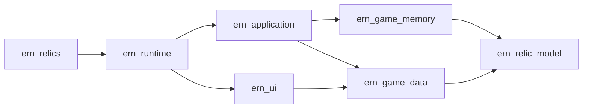

# Architecture

ERN Relics is a C++20 DLL loaded into Nightreign by Mod Engine 3. A DirectX 12
overlay presents the editor, a background worker manages editing state, and a
native adapter applies changes through the game's equipment routines.

## Modules

The project targets in [CMakeLists.txt](../CMakeLists.txt) have these dependencies:

| Code | Responsibility |
|---|---|
| [src/relics](../src/relics) | Relic types, roll rules, validation, drafts, and preset templates |
| [src/game](../src/game) | Memory layouts, equipment snapshots, location checks, writes, and recovery |
| [src/data](../src/data) | Game-file decoding, rule fingerprints, display assets, preset files, and journals |
| [src/app](../src/app) | Application workers, sessions, Undo, startup, native bindings, graphics, and input |
| [src/ui](../src/ui) | ImGui views, effect browsing, presets, diagnostics, and presentation state |

The relic model is independent of game memory, storage, and graphics. Memory and
file adapters depend on that model. `ern_application` combines them into the
runtime. `ern_runtime` owns the compiled overlay and native binding objects,
while `ern_ui` owns the UI library shared by rendering tests and the DLLs. The
final `ern_relics` DLL and its integration-test variant link those same objects;
only the integration variant adds test fixture exports.
[RuntimeEnvironment](../src/app/runtime_environment.hpp) supplies the runtime's
adapters at startup.

## Runtime and UI

[EditorApplication](../src/app/editor_application.cpp) runs a worker that owns
`Runtime`, its editing session, Undo, and preset storage. The worker polls live
state, handles commands, prepares display assets, and writes logs.

The UI reads immutable [EditorView](../src/app/editor_view.hpp) snapshots and
returns `EditorAction` commands. It keeps selection, search, and popup state
locally. The application handles one command at a time and publishes the result
in a later view. Rendering does not access game memory or files.

[Dx12Renderer](../src/app/dx12_renderer.cpp) owns GPU resources. The
[overlay](../src/app/overlay.cpp) manages graphics hooks and window input, with
renderer and ImGui state shared under one mutex. The DLL and its hooks remain
loaded until process exit. Graphics resources follow the swap chain's lifetime.
Icons share ImGui's font atlas. Their rectangles and texture references are read
when drawing because loading glyphs can resize the atlas. The renderer allocates
separate SRV descriptors for old and new textures until ImGui retires them.

## Relic editing

Normal and Deep Relics share [the same model](../src/relics/types.hpp). Each effect
stays paired with its curse. Equipment has six slots, with normal slots first.
Presets describe effects by slot and load into drafts against the relics already
equipped. File and memory adapters use [explicit effect encoding](../src/relics/effect_encoding.hpp).

[Runtime](../src/app/runtime.cpp) tracks the character session and Undo, while
[EditorSession](../src/app/editor_session.cpp) owns drafts and batch application.
Drafts retain their original relic identity. Character unloads and owner changes
clear drafts and Undo; an unreadable snapshot temporarily blocks editing.

Apply checks the active rules and live equipment, records the edit in the journal,
and submits a prepared request through [RelicEditQueue](../src/app/relic_edit_queue.cpp).
The [native adapter](../src/app/native_relic_equip.cpp) processes it after the
local character's original equipment callback returns. The transaction unequips
the relic, writes its effects, and re-equips it through the game's refresh routines.
A failed transaction attempts to restore the original state.

Completed slots stay applied if a later slot fails. Undo keeps the successful
changes from the last Apply in memory and restores them through the same write
path. The journal lives beside the DLL, and saved presets live in `presets/`.

## Game data

[game_layout.hpp](../src/game/game_layout.hpp) defines supported versions,
signatures, and offsets. The native adapter binds the game's equipment functions
and redirects the `PlayerIns` equipment callback's dispatch entry.

The relic controller must report the same cache capacity as the running game's
allocator and six-slot loop. The adapter verifies the instruction sequences with
the size operands masked. Refresh copies six scratch bitmap bits per cache entry
into the live bitmap, so the adapter checks the scratch size and the live bitmap's
length and backing storage before refreshing. Mods can use a different cache
size within the supported layout. The adapter also checks controller ownership,
mode, and the six local relic handles. Capacity failures name the failed check
before an edit starts.

[ActiveRegulation](../src/app/active_regulation.cpp) observes the active
`regulation.bin` on a separate file worker. ME3 redirection selects the file.
The first usable equipment and rule snapshot binds the rule fingerprint until
process exit. Missing, unreadable, or changed rules lock editing.

Names and icons use loose mod overrides before installed archives. Missing display
assets fall back to numeric labels and placeholders without changing validation.
